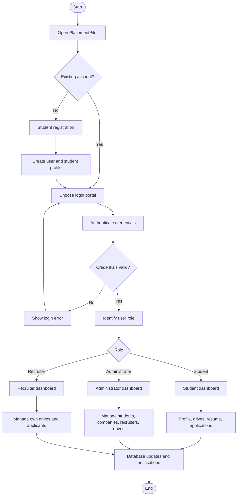
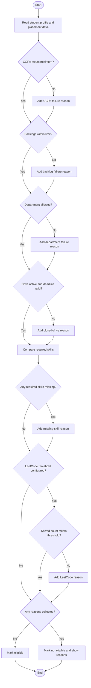
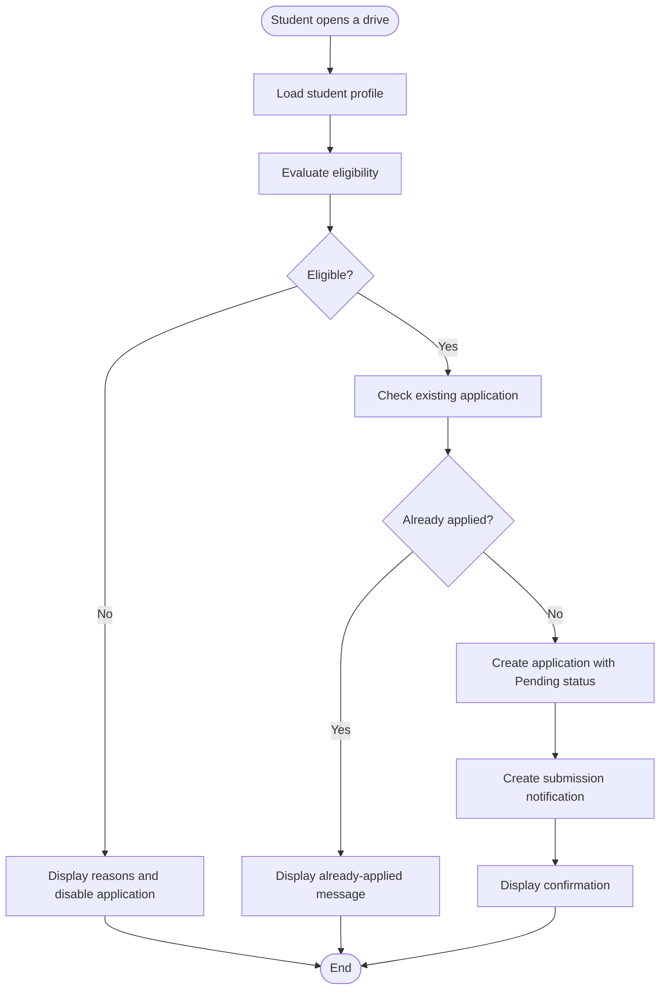
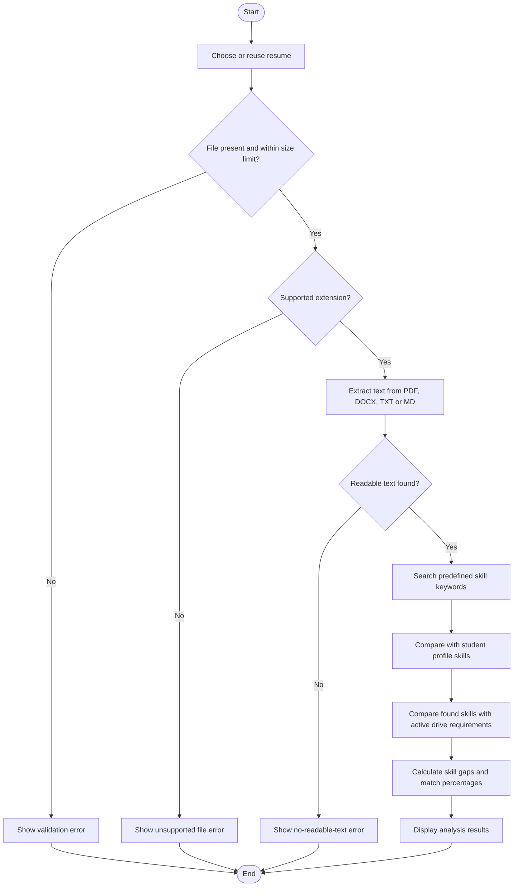
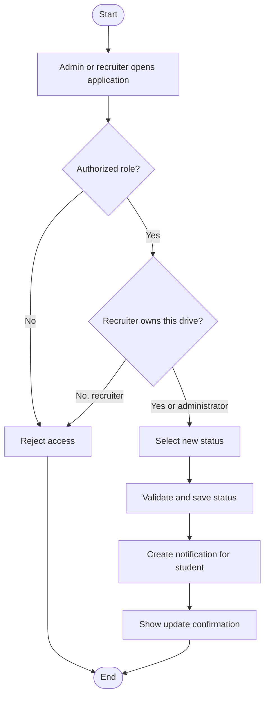

# PLACEMENTPILOT
## Flowcharts

The diagrams below use Mermaid syntax. They can be viewed in GitHub, VS Code with a Mermaid extension, or a Mermaid-compatible Markdown viewer.

---

## 1. Overall System Flow

---

## 2. Student Eligibility Flow

---

## 3. Application Submission Flow

---

## 4. Resume Analyzer Flow

---

## 5. Application Status Update Flow

