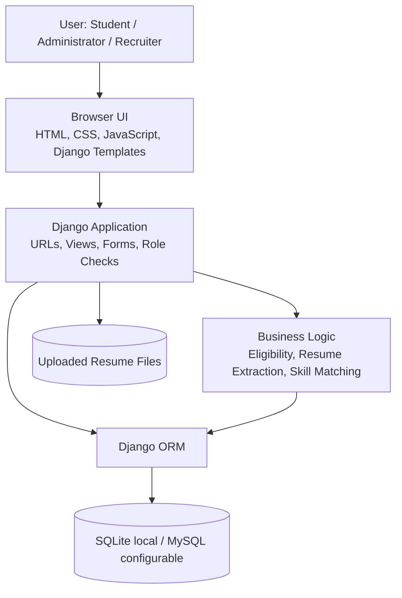
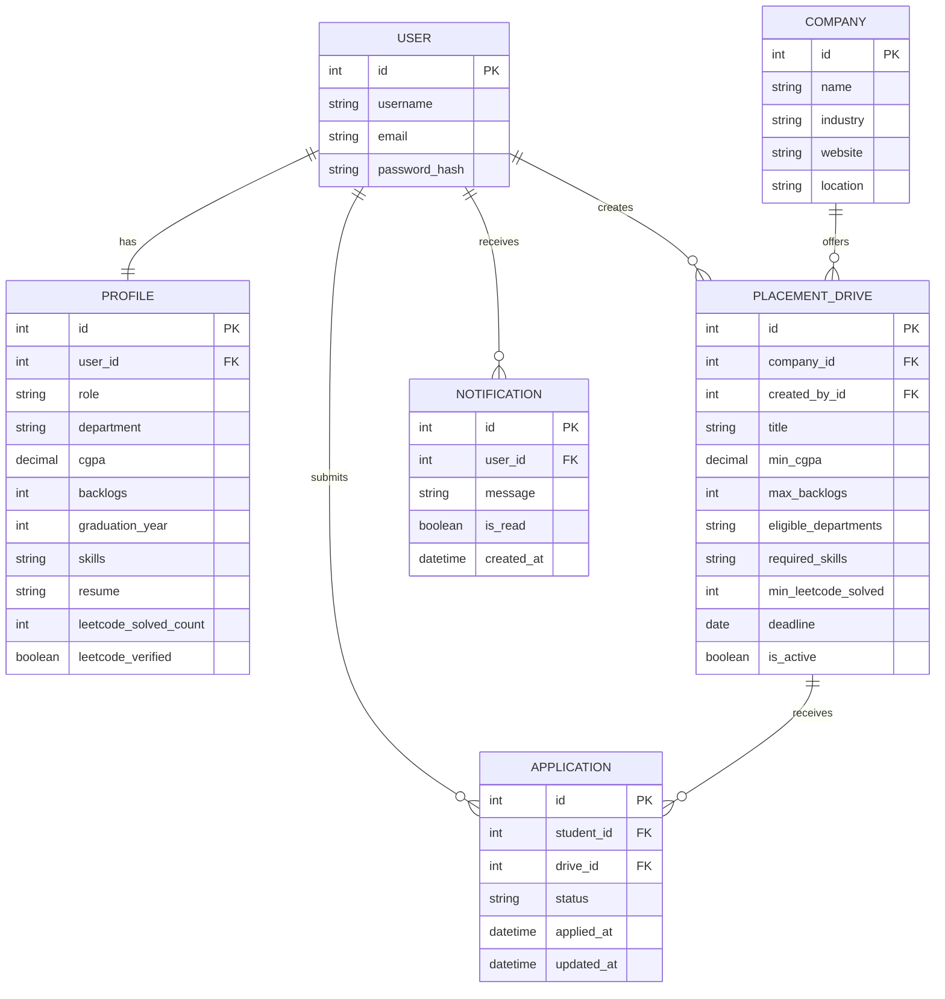

# PLACEMENTPILOT
## System Architecture and Database Design

## 1. Architecture Overview

PlacementPilot follows a server-rendered web application architecture using Django.

### Main layers

1. **Presentation layer:** Django templates, HTML, CSS, and JavaScript render pages and forms in the browser.
2. **Routing and controller layer:** Django URL patterns route requests to view functions.
3. **Business logic layer:** Eligibility evaluation, resume text extraction, skill matching, application rules, and role authorization are implemented in Python.
4. **Data access layer:** Django ORM models and queries handle persistence.
5. **Storage layer:** SQLite is the default local database; MySQL can be selected through environment configuration. Uploaded resumes are stored under the configured media directory.

## 2. Technology Stack

| Layer | Technology |
|---|---|
| Programming language | Python |
| Web framework | Django 5.2 series |
| Front end | Django Templates, HTML, CSS, JavaScript |
| ORM | Django ORM |
| Local database | SQLite |
| Configurable deployment database | MySQL |
| Resume PDF extraction | pypdf |
| Resume DOCX extraction | python-docx |
| Production application server | Gunicorn |
| Static asset serving | WhiteNoise |
| Deployment guide | Railway + MySQL configuration |

## 3. Main Functional Modules

### Student module
- Registration and login
- Academic and personal profile
- Skills and public GitHub/HackerRank/LeetCode profile references
- Resume upload and analysis
- Browse placement drives
- View eligibility reasons
- Apply to drives
- Track application status
- Receive notifications

### Administrator module
- Student directory and student profile management
- Company management
- Recruiter account management
- Placement-drive creation and management
- View drive applicants
- Overall placement dashboard
- Access Django administrative interface

### Recruiter module
- Recruiter-specific dashboard
- Manage drives created by the recruiter
- View applicants for owned drives
- Update application status
- Notify students after status changes

## 4. Database Entities

## 5. Relationship Explanation

- A user has one profile containing role and profile information.
- A company can offer multiple placement drives.
- A recruiter can create multiple placement drives.
- A student can submit applications to multiple drives.
- Each placement drive can receive applications from multiple students.
- The application table connects students and drives and has a unique constraint on the student-drive pair.
- A user can receive multiple notifications.

## 6. Important Data Rules
- Profile role values include student, admin, and recruiter.
- CGPA is constrained to the 0–10 range in the profile and drive fields.
- Application status values are pending, shortlisted, rejected, and selected.
- A student-drive pair is unique, preventing duplicate applications.
- A placement drive can define a minimum LeetCode solved count; zero means that this criterion is not enabled.
- LeetCode solved count is stored as user-supplied information and a placement-office verification flag is available.
